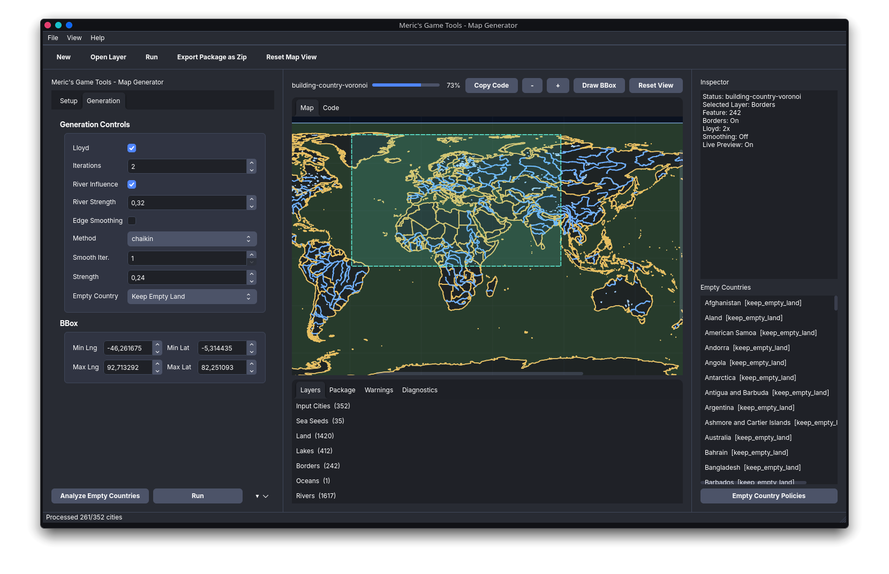

# Meric's Game Tools - Map Generator



Meric's Game Tools - Map Generator is a desktop workbench for creating Meric's Game Tools map packages. It lets you choose input GeoJSON layers, tune generation options, preview layers, generate provinces and sea regions, and export a complete package.

Repository: <https://github.com/merchizm/mgt-map-generator>

## Download

Tagged releases ship a Windows `.exe` and a Linux `.AppImage` (see [Releases](https://github.com/merchizm/mgt-map-generator/releases)). On Linux, make the AppImage executable and run it:

```bash
chmod +x MGT-Map-Generator-x86_64.AppImage
./MGT-Map-Generator-x86_64.AppImage
```

## Installation from source

```bash
python3 -m venv .venv
. .venv/bin/activate
pip install -r requirements.txt
```

Python 3.10+ is required. Run it with `python -m mgt_map_gen_py`, or `mgt-map-gen` when installed as a package.

## Inputs

| Layer | Required | Notes |
|---|---|---|
| Cities | yes | Point features. `name`, `country` and `main_city` are used. |
| Land Mask | yes | Polygons. Provinces are clipped to it. |
| Oceans | no | Polygons. Enables sea regions. |
| Sea Seeds | no | Points inside the oceans. Without them, sea regions are generated automatically. |
| Lakes | no | Polygons subtracted from land. |
| Rivers | no | Lines (or polygon outlines). Used for river influence and edge river-crossing flags. |
| Borders | no | Country polygons, used with **Use Borders** so provinces never cross a country. |

Ready-made historical borders are available from [historical-basemaps](https://github.com/aourednik/historical-basemaps) (GPL-3.0); GeoNames cities are a good city source (CC-BY 4.0).

## Features

- **Provinces** from city Voronoi cells, clipped to land, lakes and (optionally) country borders.
- **Lloyd relaxation**, **river influence** and **edge smoothing** (Chaikin or Bezier) for nicer shapes.
- **Automatic sea regions**: deterministic pseudo-random seeds, sized relative to the median land province (`Sea Cell Scale`, `Sea Seed`).
- **Empty countries** in border mode: keep empty, convert to lake, or merge into the nearest land (per-country overrides).
- **Projection**: output is a Lambert conformal conic projection in kilometres (`lcc-europe` for the default bbox), or raw `lonlat`. The projection and its parameters are written to `metadata.json`.
- **Movement graph** with real great-circle `distance` in km on every edge, port flags, river and border crossings.
- **Preview**: map and code views, per-layer list, toggleable overlays (rivers, movement edges/nodes, rail, package cities), feature inspector, bbox drawing on the map, live preview.
- **Workspaces** (`.mgtws`): File > Save Workspace stores input files and every option. Paths are saved relative to the workspace file, so you can move the folder to another machine or OS. The last session is also restored on start.
- Light and dark theme (View > Toggle Theme).
- **Export** the package as a zip.

## Package output

| File | Contents |
|---|---|
| `metadata.json` | key, name, version, projection + parameters, world size and bounds (km) |
| `provinces.geojson` | land and sea regions |
| `cities.geojson` | one city per land province, with `port` and `main_city` |
| `sea_regions.geojson` | sea regions only |
| `movement_nodes.geojson`, `movement_edges.geojson` | movement graph (`land`, `sea` and `port` edges) |
| `rail_nodes.geojson`, `rail_edges.geojson` | rail nodes for main cities. `rail_edges` is empty for now; `strait` is always `false`. |

## Command line

```bash
mgt-map-gen-cli --cities cities.geojson --land lands.json --borders borders.geojson --use-borders \
  --oceans oceans.json --out out/provinces.geojson --package-dir out --lloyd --smoothing
```

Run `mgt-map-gen-cli --help` for all options. Warnings are printed after generation.

## Building the executables

CI (`.github/workflows/build.yml`) builds both on every `v*` tag (or by hand from the Actions tab) and attaches them to the GitHub release. Locally:

```bash
pip install pyinstaller pillow
pyinstaller --noconfirm --windowed --name mgt-map-gen --paths . --icon assets/icon.png \
  --add-data "mgt_map_gen_py/ui/icons:mgt_map_gen_py/ui/icons" packaging/launcher.py
packaging/build_appimage.sh   # Linux only
```

On Windows use `;` instead of `:` in `--add-data`.
